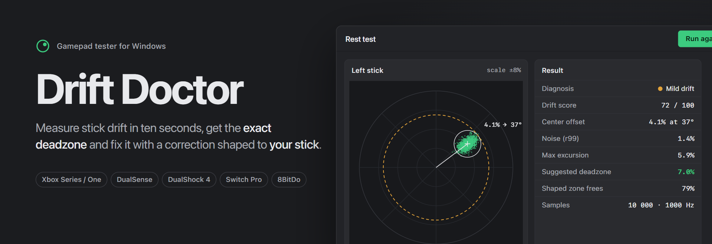
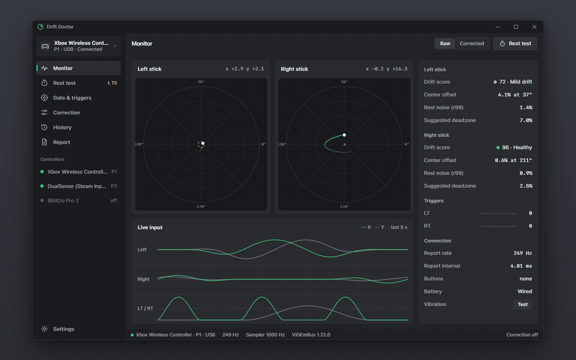
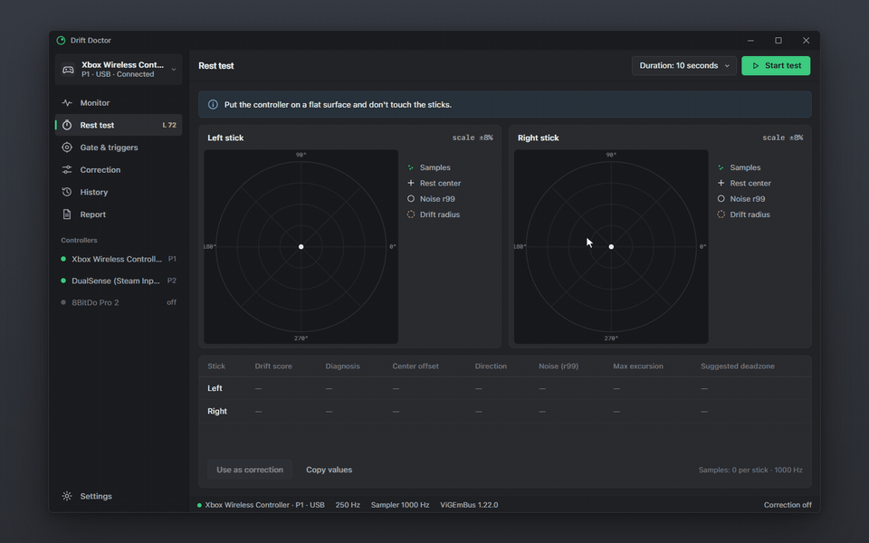
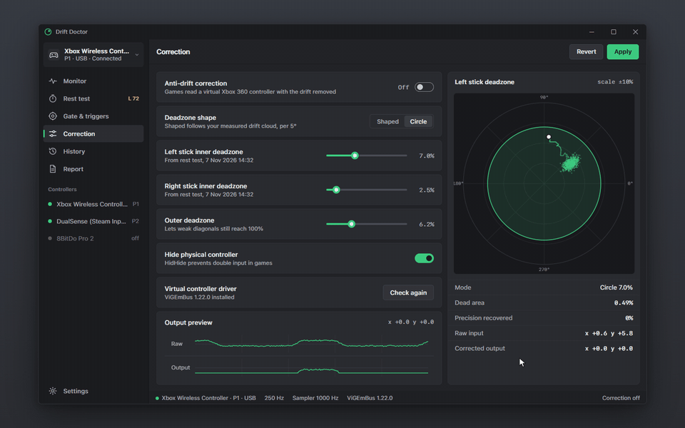
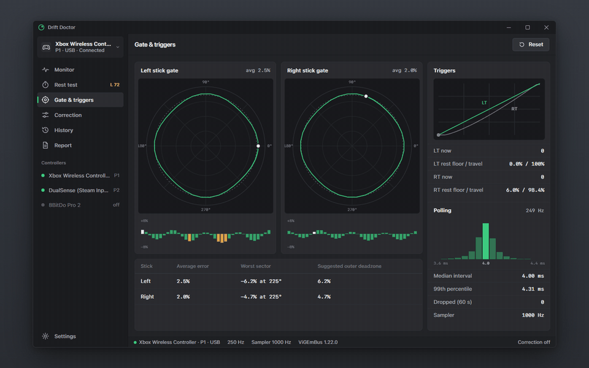
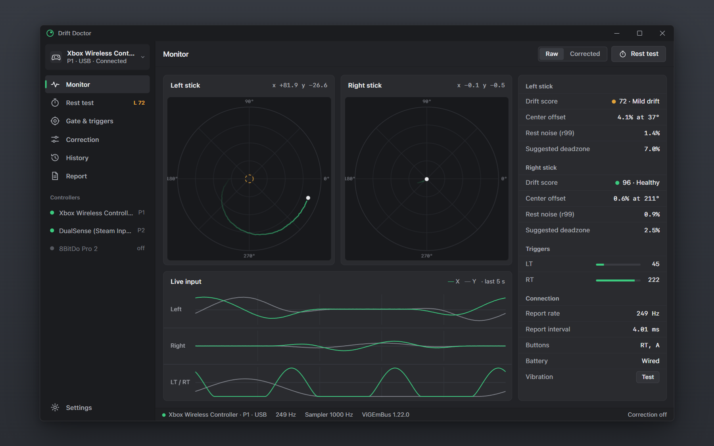
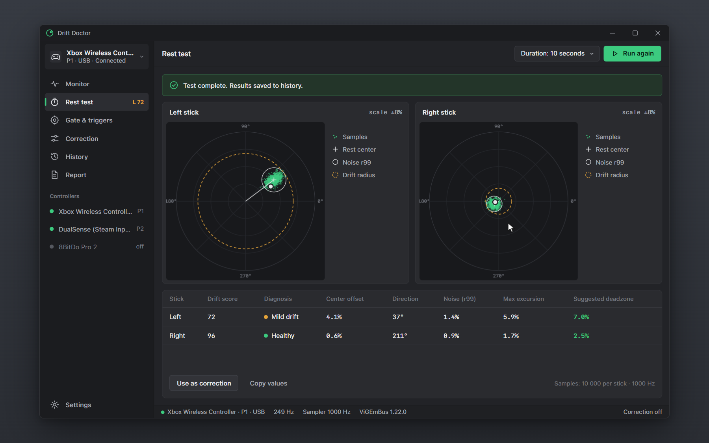
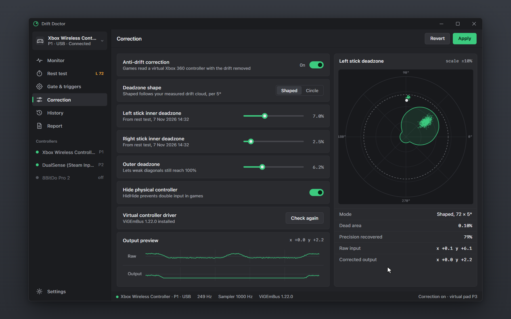
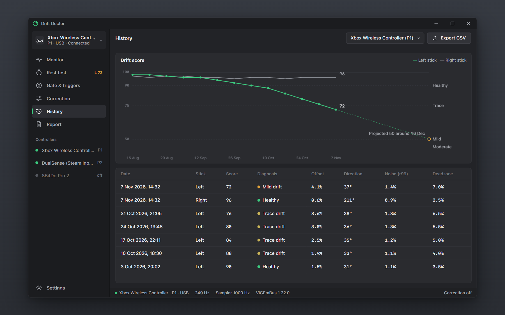
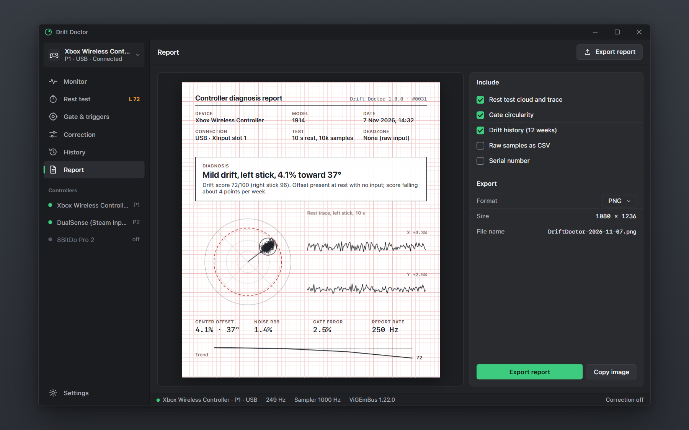

<div align="center">



**Stick drift test, deadzone calculator and drift fix for Xbox, PS5 DualSense, PS4, Switch Pro and 8BitDo controllers on Windows.**

[](#quick-start)
[](#build-from-source)
[](LICENSE)
[](#quick-start)
[](#quick-start)
[](#faq)

<a href="../../releases/latest" class="download-btn-action"></a>

</div>

Drift Doctor is a free **controller drift test** and **gamepad tester** for Windows that measures **stick drift** instead of guessing it. Put your controller down for ten seconds and it tells you how far each stick drifts, in which direction, how noisy it is, and the exact **deadzone** that hides it, then it can fix the drift for every game with a deadzone shaped to your stick.

<p align="center"></p>

## Why Drift Doctor

Most joystick testers show a dot moving in a circle and leave the diagnosis to you. Drift Doctor treats your controller like a patient: it records, measures and writes a diagnosis such as **"Mild drift, left stick, 4.1% toward 37°"**.

### Drift Score and a real diagnosis

Every stick gets a **Drift Score from 0 to 100** (100 is healthy) built from the center offset and the rest noise, plus a severity band: No drift, Trace, Mild, Moderate or Severe. The sidebar badge tells you at a glance which stick is getting worse.

### 10-second Rest Test and deadzone calculator

The rest test captures thousands of raw XInput reports per stick with no deadzone applied, plots the **scatter cloud**, and computes the 99th-percentile noise radius, the center offset and its angle. From that it recommends the smallest **inner deadzone** that hides the drift, per stick, with a safety margin you control.

<p align="center"></p>

### Shaped anti-drift correction

A round deadzone must be as big as the worst direction of the drift, so it also swallows small aim moves in every other direction. Drift Doctor builds a **per-angle deadzone** (72 directions, 5° each) from the measured drift cloud and feeds corrected input to games through a **ViGEmBus virtual Xbox 360 controller**, with HidHide hiding the physical pad. On the example controller this frees 79% of the dead area compared with a 7% circle.

<p align="center"></p>

### Gate circularity, trigger linearity and polling rate

Roll the stick around its gate to get the **circularity error per 10° sector** and a suggested outer deadzone. Pull the triggers to see their rest floor, travel and how many of the 256 steps they really report. Wiggle a stick to measure the **real polling rate in Hz** from XInput packet numbers, plus the median report interval.

<p align="center"></p>

### Drift history and warranty report

Every rest test lands in a history chart, so you can watch a stick degrade over weeks and catch it while it is still under warranty. One click exports a **diagnosis report image** with the scatter plot, measurements and trend to attach to a support or RMA ticket.

### Compared with the usual tools

| | Drift Doctor | Vendor apps (Xbox Accessories, DualSense tools) | Web gamepad testers | Steam Input |
|---|:---:|:---:|:---:|:---:|
| Live stick and trigger view | Yes | Yes | Yes | Yes |
| Measured drift (offset, angle, noise r99) | Yes | No | No | No |
| Drift Score and written diagnosis | Yes | No | No | No |
| Deadzone recommendation per stick | Yes | No | No | No |
| Per-angle shaped deadzone | Yes | No | No | No |
| Works in every game (virtual controller) | Yes | Partly | No | Steam games |
| Circularity error per sector | Yes | No | Some | No |
| Real polling rate in Hz | Yes | No | Some | No |
| Drift history over weeks | Yes | No | No | No |
| Warranty report image | Yes | No | No | No |
| Offline, portable, no account | Yes | No | Browser | No |

## Screenshots

| | |
|---|---|
|  |  |
| Monitor | Rest test |
|  |  |
| Correction | History |
|  | |
| Report | |

## Quick start

1. Download `DriftDoctor-v1.0.0-win-x64.zip` from the <a href="../../releases/latest" class="download-btn-action">latest release</a>.
2. Unzip anywhere and run `DriftDoctor.exe`. It is portable: no installer, no admin rights, no account.
3. Connect your controller over USB or Bluetooth. Open **Rest test**, put the controller on a table and press **Start test**.
4. Optional: to apply the correction in games, install [ViGEmBus](https://github.com/nefarius/ViGEmBus) and [HidHide](https://github.com/nefarius/HidHide) yourself (these drivers need admin rights once), then switch on **Anti-drift correction**.

Settings and history are stored as JSON in `%APPDATA%\DriftDoctor\`.

## Supported controllers

Anything that shows up as an XInput device works directly. Other pads work through the usual XInput layers (Steam Input, DS4Windows, BetterJoy, or the controller's own XInput mode):

- **Microsoft**: Xbox Series X|S Wireless Controller, Xbox One controller, Xbox Elite Series 2, Xbox 360 controller
- **Sony**: PS5 DualSense, DualSense Edge, PS4 DualShock 4 (via Steam Input or DS4Windows)
- **Nintendo**: Switch Pro Controller (via Steam Input or BetterJoy)
- **8BitDo**: Pro 2, Ultimate, SN30 Pro, Lite 2 in X-input mode
- **Others**: GameSir, PowerA, PDP, Logitech F310/F710, Thrustmaster, generic XInput gamepads

A native HID reader for DualSense and Switch Pro is on the roadmap.

## FAQ

**How do I test my controller for stick drift on PC?**
Open Drift Doctor, go to Rest test, put the controller on a flat surface and press Start test. After 10 seconds you get the center offset, direction, rest noise and a Drift Score for each stick. Anything below 90 means measurable drift.

**How do I fix stick drift on a PS5 DualSense controller on PC?**
Run the rest test with the DualSense connected through Steam Input or DS4Windows, then use the suggested deadzone in your game, or turn on Anti-drift correction so every game reads a virtual Xbox controller with the drift removed. Cleaning or replacing the stick module is the only permanent hardware fix.

**What deadzone should I use for stick drift?**
The smallest one that covers your measured drift. Drift Doctor computes it as center offset plus 99th-percentile noise radius, plus a 15% margin, rounded up to 0.5%. A typical healthy stick needs 2 to 3%; a drifting one often needs 6 to 10%.

**Is the Xbox controller drift test accurate?**
It reads the raw values the game would see, at up to 1000 samples per second, with no deadzone applied. Leave the controller untouched during the test; any touch shows up as an outlier cloud.

**What is a shaped (anisotropic) deadzone?**
A deadzone whose radius changes with direction. Drift pushes the stick one way, so the dead area only needs to be large in that direction. Small aim moves the other way stay usable instead of being swallowed by a big circle.

**Does Drift Doctor send any data?**
No. There is no telemetry, no account and no network access. Reports are only saved when you export them.

**How do I check my controller polling rate?**
Open Gate & triggers and move a stick continuously. The report rate comes from XInput packet numbers, so it shows what the controller actually delivers, not the USB descriptor.

## Build from source

Requires Windows 10/11 and the Rust MSVC toolchain.

```
git clone https://github.com/<you>/drift-doctor
cd drift-doctor
cargo build --release
target\release\DriftDoctor.exe
```

```
drift-doctor/
  src/
    main.rs          window setup
    app.rs           pages, sample routing, rest test state machine
    input.rs         XInput sampler thread (slots 0-3, ~1000 Hz)
    stats.rs         rest analysis, Drift Score, circularity, triggers, polling meter
    correction.rs    shaped deadzone, CorrectionBackend trait, ViGEmBus detection
    store.rs         settings, history, report image export
    widgets.rs       polar stick plot, time lanes, rows, toggles, icons
    theme.rs         palette and font loading
  docs/design/       HTML design mockup and banner
  assets/            screenshots and demo GIFs
```

## Roadmap

- [x] XInput sampler thread with packet-number polling meter
- [x] Rest test: center offset, angle, r99 noise, Drift Score, deadzone recommendation
- [x] Shaped per-angle deadzone from the drift cloud
- [x] Circularity per sector, trigger floor and resolution
- [x] Drift history and report image export (BMP)
- [x] `CorrectionBackend` trait with a preview backend and ViGEmBus detection
- [ ] ViGEmBus transport (virtual Xbox 360 / DualShock 4 target)
- [ ] HidHide integration toggle
- [ ] Native HID input for DualSense, DualShock 4 and Switch Pro
- [ ] PNG report export and copy to clipboard
- [ ] CSV export of raw rest samples
- [ ] Light theme

## Contributing

Issues and pull requests are welcome. Please run `cargo fmt` and `cargo clippy` before sending a PR, and include a rest-test screenshot when you report a controller that measures oddly.

## License

[MIT](LICENSE) © Drift Doctor contributors.

Drift Doctor is not affiliated with or endorsed by Microsoft, Sony Interactive Entertainment, Nintendo, 8BitDo or Valve. Xbox, DualSense, DualShock, PlayStation, Nintendo Switch and Steam are trademarks of their respective owners. ViGEmBus and HidHide are separate projects by Nefarius Software Solutions.

## Keywords

stick drift fix, controller drift test, gamepad tester, joystick drift test, deadzone calculator, PS5 controller drift PC, DualSense drift fix, Xbox controller drift PC, Xbox Series controller drift, PS4 DualShock 4 drift, Switch Pro controller drift, analog stick tester, controller polling rate test, joystick circularity test, anti-deadzone, XInput tester, ViGEmBus deadzone, Windows gamepad test
